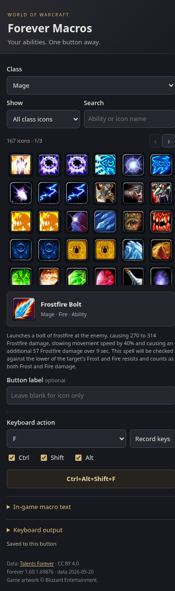

# WoW Forever Macros for OpenDeck

Put your **World of Warcraft Forever** abilities on your Stream Deck. Pick a class, choose an ability icon, and set the keyboard shortcut that the button should press.

Works with **OpenDeck on Linux**. Includes **642 offline icons** for all nine Forever classes, plus talents, racials, and Legacy perks.

[**Download the plugin**](https://github.com/cooldead/opendeck-wow-forever/releases/latest) · [OpenDeck](https://github.com/nekename/OpenDeck) · [Talents Forever](https://talentsforever.com/)



## What you can do

- Browse icons by class or search for an ability by name.
- Assign a key, such as `1`, `F`, or `F2`.
- Add **Ctrl**, **Shift**, and **Alt**, including combinations of all three.
- Record a shortcut by pressing it on your keyboard.
- Give each button its own icon, label, and shortcut.
- Write and save macro text to copy into WoW.
- Browse the included icons without an internet connection.

## What you need

- Linux with [OpenDeck](https://github.com/nekename/OpenDeck) installed.
- A Stream Deck or another controller supported by your OpenDeck setup.
- **Node.js 22.4 or newer**.
- **xdotool** for the default keyboard mode. If WoW uses native Wayland, see [Keyboard output](#keyboard-output).

This version supports Linux only.

## Install

1. Open the [latest release](https://github.com/cooldead/opendeck-wow-forever/releases/latest).
2. Download the file ending in **`.streamDeckPlugin`**. You do not need the source-code ZIP.
3. Open **OpenDeck → Plugins** and import that file.
4. Restart OpenDeck if **WoW Forever** does not appear in the action list.

To update later, download and import the newer release the same way.

## Set up your first button

1. In OpenDeck, drag **WoW Forever → Ability / Macro** onto a button.
2. Click the button to open its settings.
3. Choose your **Class**.
4. Search for an ability and click its icon.
5. Under **Keyboard action**, choose a key and tick any modifiers you want. You can also click **Record keys** and press the shortcut.
6. In WoW, bind that same shortcut to the action-bar slot containing your ability.
7. Return focus to the game and press the Stream Deck button.

Your settings save automatically. Repeat these steps for each button you want to add.

### Example: Frostfire Bolt

Choose **Mage**, search for **Frostfire Bolt**, and select its icon. Set the keyboard action to **F** with **Ctrl** checked.

In WoW, put Frostfire Bolt on your action bar and bind that slot to **Ctrl+F**. Pressing the deck button now sends **Ctrl+F** to the game.

Choosing an icon does not create a key binding inside WoW—you set that binding in the game.

## Use an in-game macro

1. Select an ability icon in the plugin.
2. Expand **In-game macro text**.
3. Click **Generate /cast macro**, or type your own macro.
4. Click **Copy text**.
5. In WoW, type `/macro`, create a macro, and paste the text.
6. Drag the macro onto your action bar and bind its slot to the shortcut configured in the plugin.

For example:

```text
#showtooltip Frostfire Bolt
/cast Frostfire Bolt
```

The plugin saves your macro text for reference. To change the macro used by the game, copy your updated text into WoW again.

Each button press sends **one keyboard shortcut**. Holding the button does not repeat it. Passive talents and Legacy perks can be used as button icons, but cannot be cast. To use a particular spell rank, add it to your macro text, such as `/cast Frostbolt(Rank 1)`.

## Keyboard output

Most users running WoW through Wine on XWayland can keep the default setting.

| How your game runs | Setting under Keyboard output | Required tool |
| --- | --- | --- |
| X11 or Wine on XWayland | X11 / Wine on XWayland | `xdotool` |
| Native Wayland | Native Wayland | `ydotool` with `ydotoold` running |

Your desktop can use Wayland while WoW still runs through XWayland. In that case, use the default **xdotool** setting.

For native Wayland, install and configure [ydotool](https://github.com/ReimuNotMoe/ydotool) using your distribution’s instructions. Its service must allow your user to access its socket and the virtual input device. If you use a custom socket, OpenDeck needs the matching `YDOTOOL_SOCKET` environment variable.

**Keep WoW focused when using the buttons.** Shortcuts go to the currently focused application.

## Troubleshooting

**The WoW Forever category is missing.**
Restart OpenDeck. Check that Node.js 22.4 or newer is installed by running `node --version` in a terminal.

**The icon appears, but the ability does nothing.**
Click back into WoW, then check that the plugin shortcut matches the game’s action-bar binding. Try that shortcut on your physical keyboard first.

**The button shows an error.**
Open its settings to read the error message. Check that the selected keyboard tool is installed. For native Wayland, also check that `ydotoold` is running and accessible to your user.

**An icon shows a question mark.**
Some general abilities have no icon mapping in the source data. Choose another icon using **Show → Full icon library**.

**Copy text does not copy automatically.**
The plugin selects the macro text for you. Press **Ctrl+C**, then paste it into WoW.

**An ability or description has changed in Forever.**
The bundled data is a snapshot. Check for a newer release or follow the data-update instructions below.

## Data and credits

Ability and talent data comes from [Talents Forever](https://talentsforever.com/), by Chris Baldwin, under [CC BY 4.0](https://creativecommons.org/licenses/by/4.0/).

The included snapshot is dated **November 4, 2026**, for Forever launch build **1.60.1.70755** (after the Paladin, Druid and Rogue reworks). It contains **1,319 entries and all 623 icons referenced by that source**, plus 19 icons from the earlier snapshot kept so buttons made with retired abilities still show their icon. Some source descriptions use demo or Classic fallback text. This is not a collection of every texture in the game client.

World of Warcraft names, game text, and artwork belong to Blizzard Entertainment. This is an unofficial fan project. See [NOTICE.md](NOTICE.md) for full attribution.

## For developers

No npm dependencies are needed. The plugin uses Node.js; the packaging and data scripts use Python 3. Downloading updated data also requires `curl`.

```sh
git clone https://github.com/cooldead/opendeck-wow-forever.git
cd opendeck-wow-forever
npm test
npm run package
```

The installable file is created in `dist/`.

To update the bundled Forever data and download newly referenced icons:

```sh
npm run sync
npm test
npm run package
```

Import the rebuilt package into OpenDeck. The sync script reuses existing icon images; if a specific image has changed, remove its cached JPEG from `plugin/icons/` before syncing. The three PNG copies used by the plugin menu are bundled separately.

To preview the settings page:

```sh
python -m http.server 8765 --directory plugin
```

Open `http://localhost:8765/inspector.html`. Preview mode does not save to OpenDeck or send keystrokes. Optional browser checks run with `node tests/browser.mjs` and require Brave Browser.

### Project files

| Folder | Contents |
| --- | --- |
| `plugin/` | Plugin code, settings page, catalog, and icons |
| `data/` | Original Talents Forever data snapshot |
| `scripts/` | Data download and packaging scripts |
| `tests/` | Automated checks |
| `docs/` | README screenshot |
| `dist/` | Generated installable package; not tracked in Git |
